<a id="top"></a>

<p align="center">
<picture>
  <source media="(prefers-color-scheme: dark)" srcset="./assets/dark/hero.svg">
  <source media="(prefers-color-scheme: light)" srcset="./assets/light/hero.svg">
  
</picture>
</p>

<p align="center">
  <a href="#whoami">
    <picture>
      <source media="(prefers-color-scheme: dark)" srcset="./assets/dark/nav-whoami.svg">
      <source media="(prefers-color-scheme: light)" srcset="./assets/light/nav-whoami.svg">
      
    </picture>
  </a>
  <a href="#stack">
    <picture>
      <source media="(prefers-color-scheme: dark)" srcset="./assets/dark/nav-stack.svg">
      <source media="(prefers-color-scheme: light)" srcset="./assets/light/nav-stack.svg">
      
    </picture>
  </a>
  <a href="#projects">
    <picture>
      <source media="(prefers-color-scheme: dark)" srcset="./assets/dark/nav-projects.svg">
      <source media="(prefers-color-scheme: light)" srcset="./assets/light/nav-projects.svg">
      
    </picture>
  </a>
  <a href="#experience">
    <picture>
      <source media="(prefers-color-scheme: dark)" srcset="./assets/dark/nav-experience.svg">
      <source media="(prefers-color-scheme: light)" srcset="./assets/light/nav-experience.svg">
      
    </picture>
  </a>
  <a href="#metrics">
    <picture>
      <source media="(prefers-color-scheme: dark)" srcset="./assets/dark/nav-metrics.svg">
      <source media="(prefers-color-scheme: light)" srcset="./assets/light/nav-metrics.svg">
      
    </picture>
  </a>
  <a href="#hire">
    <picture>
      <source media="(prefers-color-scheme: dark)" srcset="./assets/dark/nav-hire.svg">
      <source media="(prefers-color-scheme: light)" srcset="./assets/light/nav-hire.svg">
      
    </picture>
  </a>
</p>

<a id="whoami"></a>

<picture>
  <source media="(prefers-color-scheme: dark)" srcset="./assets/dark/h-whoami.svg">
  <source media="(prefers-color-scheme: light)" srcset="./assets/light/h-whoami.svg">
  
</picture>


<a id="stack"></a>

<picture>
  <source media="(prefers-color-scheme: dark)" srcset="./assets/dark/h-stack.svg">
  <source media="(prefers-color-scheme: light)" srcset="./assets/light/h-stack.svg">
  
</picture>

<picture>
  <source media="(prefers-color-scheme: dark)" srcset="./assets/dark/flow.svg">
  <source media="(prefers-color-scheme: light)" srcset="./assets/light/flow.svg">
  
</picture>

<p align="center"><sub>green hits Redis and returns fast · amber goes to the database · red gets rate-limited</sub></p>

<picture>
  <source media="(prefers-color-scheme: dark)" srcset="./assets/dark/stack.svg">
  <source media="(prefers-color-scheme: light)" srcset="./assets/light/stack.svg">
  
</picture>

<a id="projects"></a>

<picture>
  <source media="(prefers-color-scheme: dark)" srcset="./assets/dark/h-projects.svg">
  <source media="(prefers-color-scheme: light)" srcset="./assets/light/h-projects.svg">
  
</picture>

<p align="center">
  <a href="https://github.com/shahnawaz-hussaink/irctc-backend">
    <picture>
      <source media="(prefers-color-scheme: dark)" srcset="./assets/dark/p-irctc.svg">
      <source media="(prefers-color-scheme: light)" srcset="./assets/light/p-irctc.svg">
      
    </picture>
  </a>
  <a href="https://github.com/shahnawaz-hussaink/debug-arena">
    <picture>
      <source media="(prefers-color-scheme: dark)" srcset="./assets/dark/p-debug-arena.svg">
      <source media="(prefers-color-scheme: light)" srcset="./assets/light/p-debug-arena.svg">
      
    </picture>
  </a>
</p>

<p align="center">
  <a href="https://github.com/shahnawaz-hussaink/Backend_Video_Tube">
    <picture>
      <source media="(prefers-color-scheme: dark)" srcset="./assets/dark/p-videotube.svg">
      <source media="(prefers-color-scheme: light)" srcset="./assets/light/p-videotube.svg">
      
    </picture>
  </a>
  <a href="https://github.com/shahnawaz-hussaink/otp-verification-system">
    <picture>
      <source media="(prefers-color-scheme: dark)" srcset="./assets/dark/p-otp.svg">
      <source media="(prefers-color-scheme: light)" srcset="./assets/light/p-otp.svg">
      
    </picture>
  </a>
</p>

<p align="center">
  <a href="https://github.com/shahnawaz-hussaink/URL-Shortener">
    <picture>
      <source media="(prefers-color-scheme: dark)" srcset="./assets/dark/p-url-shortener.svg">
      <source media="(prefers-color-scheme: light)" srcset="./assets/light/p-url-shortener.svg">
      
    </picture>
  </a>
  <a href="https://github.com/u-b-001/main">
    <picture>
      <source media="(prefers-color-scheme: dark)" srcset="./assets/dark/p-mosai.svg">
      <source media="(prefers-color-scheme: light)" srcset="./assets/light/p-mosai.svg">
      
    </picture>
  </a>
</p>

<p align="right"><sub><a href="https://debug-arena.vercel.app">debug-arena live demo ↗</a> &nbsp;·&nbsp; <a href="https://github.com/shahnawaz-hussaink?tab=repositories">all repositories →</a></sub></p>

<a id="experience"></a>

<picture>
  <source media="(prefers-color-scheme: dark)" srcset="./assets/dark/h-experience.svg">
  <source media="(prefers-color-scheme: light)" srcset="./assets/light/h-experience.svg">
  
</picture>

<picture>
  <source media="(prefers-color-scheme: dark)" srcset="./assets/dark/timeline.svg">
  <source media="(prefers-color-scheme: light)" srcset="./assets/light/timeline.svg">
  
</picture>

<a id="metrics"></a>

<picture>
  <source media="(prefers-color-scheme: dark)" srcset="./assets/dark/h-metrics.svg">
  <source media="(prefers-color-scheme: light)" srcset="./assets/light/h-metrics.svg">
  
</picture>

<picture>
  <source media="(prefers-color-scheme: dark)" srcset="./assets/dark/metrics.svg">
  <source media="(prefers-color-scheme: light)" srcset="./assets/light/metrics.svg">
  
</picture>

<picture>
  <source media="(prefers-color-scheme: dark)" srcset="./assets/dark/activity.svg">
  <source media="(prefers-color-scheme: light)" srcset="./assets/light/activity.svg">
  
</picture>

<details>
<summary><b><code>GET /v1/changelog</code></b> &nbsp;<sub>what changed in me lately</sub></summary>
<br/>

```diff
+ joined      SamarthX eGov · CyPSi Lab, DU (building real-time ingestion APIs)
+ shipped     debug-arena to a live multi-college tournament: 35+ coders, 0 crashes
+ added       PostgreSQL + Prisma, because row-level locks beat hoping for the best
+ added       BullMQ: if it can be async, it goes in a queue
+ added       Go: goroutines are my new love language
+ added       Angular, to understand the people calling my APIs
- removed     fear of production deploys
- deprecated  console.log debugging (mostly)

@@ in progress @@
  system design: caching, scaling, failure modes
  distributed locks & idempotent APIs
  Go concurrency patterns
```
</details>

<a id="hire"></a>

<picture>
  <source media="(prefers-color-scheme: dark)" srcset="./assets/dark/h-hire.svg">
  <source media="(prefers-color-scheme: light)" srcset="./assets/light/h-hire.svg">
  
</picture>

<picture>
  <source media="(prefers-color-scheme: dark)" srcset="./assets/dark/cta.svg">
  <source media="(prefers-color-scheme: light)" srcset="./assets/light/cta.svg">
  
</picture>

<p align="center">
  <a href="mailto:shahnawaz.hussain96508@gmail.com?subject=Let's%20build%20something">
    <picture>
      <source media="(prefers-color-scheme: dark)" srcset="./assets/dark/btn-email.svg">
      <source media="(prefers-color-scheme: light)" srcset="./assets/light/btn-email.svg">
      
    </picture>
  </a>
  <a href="https://linkedin.com/in/shahnawaz-hussain-00b7b8226/">
    <picture>
      <source media="(prefers-color-scheme: dark)" srcset="./assets/dark/btn-linkedin.svg">
      <source media="(prefers-color-scheme: light)" srcset="./assets/light/btn-linkedin.svg">
      
    </picture>
  </a>
  <a href="https://shahcodes.dev">
    <picture>
      <source media="(prefers-color-scheme: dark)" srcset="./assets/dark/btn-portfolio.svg">
      <source media="(prefers-color-scheme: light)" srcset="./assets/light/btn-portfolio.svg">
      
    </picture>
  </a>
  <a href="https://drive.google.com/file/d/1JuRU85oUYq18H_MdXWuy7cSG0YM4-Nut/view?usp=share_link">
    <picture>
      <source media="(prefers-color-scheme: dark)" srcset="./assets/dark/btn-resume.svg">
      <source media="(prefers-color-scheme: light)" srcset="./assets/light/btn-resume.svg">
      
    </picture>
  </a>
  <a href="https://leetcode.com/shahnawazhussaink">
    <picture>
      <source media="(prefers-color-scheme: dark)" srcset="./assets/dark/btn-leetcode.svg">
      <source media="(prefers-color-scheme: light)" srcset="./assets/light/btn-leetcode.svg">
      
    </picture>
  </a>
  <a href="https://twitter.com/k_shahnawazhuss">
    <picture>
      <source media="(prefers-color-scheme: dark)" srcset="./assets/dark/btn-x.svg">
      <source media="(prefers-color-scheme: light)" srcset="./assets/light/btn-x.svg">
      
    </picture>
  </a>
  <a href="https://instagram.com/shahnawaz.hussaink">
    <picture>
      <source media="(prefers-color-scheme: dark)" srcset="./assets/dark/btn-instagram.svg">
      <source media="(prefers-color-scheme: light)" srcset="./assets/light/btn-instagram.svg">
      
    </picture>
  </a>
</p>

<picture>
  <source media="(prefers-color-scheme: dark)" srcset="./assets/dark/footer.svg">
  <source media="(prefers-color-scheme: light)" srcset="./assets/light/footer.svg">
  
</picture>

<p align="right"><sub><a href="#top">↑ back to top</a> &nbsp;·&nbsp; every image here is generated by <a href="./scripts/build.py">scripts/build.py</a></sub></p>
