<p align="center">
  
</p>

<p align="center">
  <a href="https://shahcodes.dev"><code>portfolio</code></a> &nbsp;·&nbsp;
  <a href="https://drive.google.com/file/d/1JuRU85oUYq18H_MdXWuy7cSG0YM4-Nut/view?usp=share_link"><code>resume.pdf</code></a> &nbsp;·&nbsp;
  <a href="https://linkedin.com/in/shahnawaz-hussain-00b7b8226/"><code>linkedin</code></a> &nbsp;·&nbsp;
  <a href="https://www.leetcode.com/shahnawazhussaink"><code>leetcode</code></a> &nbsp;·&nbsp;
  <a href="https://twitter.com/k_shahnawazhuss"><code>x</code></a> &nbsp;·&nbsp;
  <a href="https://instagram.com/shahnawaz.hussaink"><code>instagram</code></a> &nbsp;·&nbsp;
  <a href="mailto:shahnawaz.hussain96508@gmail.com"><code>email</code></a>
</p>

<br/>

> Most developers list their stack. I'd rather show you what happens to a request when it hits it.

<br/>

## `GET /v1/stack`

<p align="center">
  
</p>

<p align="center"><sub>green hits Redis and returns fast · amber goes to the database · red gets rate-limited. Every box is something I build with.</sub></p>

<br/>

## `GET /v1/projects?sort=hardest_problem`

| `resource` | `the hard part` | `stack` |
| :-- | :-- | :-- |
| **[irctc-backend](https://github.com/shahnawaz-hussaink/irctc-backend)**<br/><sub>railway booking engine</sub> | Two users, one seat, same millisecond. `SELECT … FOR UPDATE` row locks inside ACID transactions, 10-minute TTL seat holds, BullMQ workers for waitlist promotion and emails, and Redis-backed rate limits at four tiers. | Node · Express · PostgreSQL · Prisma · Redis · BullMQ |
| **[debug-arena](https://github.com/shahnawaz-hussaink/debug-arena)**<br/><sub>live DSA tournaments · [demo](https://debug-arena.vercel.app)</sub> | Ran a live multi-college tournament with 35+ participants, crash-free. Strict timers, real-time monitoring, sandboxed code execution through Judge0. | React · Express · Firestore · Judge0 |
| **[Backend_Video_Tube](https://github.com/shahnawaz-hussaink/Backend_Video_Tube)**<br/><sub>YouTube-style backend</sub> | The full content lifecycle: Multer → Cloudinary uploads, JWT access/refresh rotation, subscriptions, likes, comments, and aggregation pipelines for watch history. | Node · Express · MongoDB · Cloudinary |
| **[otp-verification-system](https://github.com/shahnawaz-hussaink/otp-verification-system)**<br/><sub>OTP over email & SMS</sub> | OTPs that expire on their own (Redis TTL), can't be brute-forced (rate limits), and are generated with `crypto`, not `Math.random`. | Node · Redis · Twilio · Nodemailer |
| **[URL-Shortener](https://github.com/shahnawaz-hussaink/URL-Shortener)**<br/><sub>link management backend</sub> | Collision-resistant NanoID codes, custom slugs, link expiry, IP geolocation and per-link click analytics. | Node · Express · JWT · NanoID |
| **[MOSAI CMS](https://github.com/u-b-001/main)**<br/><sub>contributor · [mosai.org.in](https://mosai.org.in)</sub> | Headless CMS backend running in production: dynamic content collections, role-based access control, REST + GraphQL APIs. | Payload CMS · Next.js · TypeScript |

<p align="right"><sub><a href="https://github.com/shahnawaz-hussaink?tab=repositories">GET /v1/projects?page=2 →</a></sub></p>

<br/>

## `GET /v1/experience`

```yaml
- role: Developer
  org: SamarthX eGov · Cyber Physical Systems (CyPSi) Lab, University of Delhi
  period: Jun 2026 – present
  work:
    - real-time backend architectures and data-ingestion APIs
    - backend systems + admin dashboards for CMS and content-management tools
  optimising_for: [scalability, correctness]

- role: Organising Conference Member
  org: India's International Movement to Unite Nations (IIMUN)
  period: Sep 2025 – Jan 2026
  work:
    - ran operational workflows and scheduling for large virtual delegation conferences
    - led communications across university and high-school delegates

- event: Pitchcraft            # Oct 2025 · team CAFFeINE-CORRUPT
  built: AI rental platform with AI matching, a "rental DNA" score and verified listings
  stack: [Next.js, FastAPI, Supabase]

- event: AceHack, Jaipur       # Mar 2025
  built: expense tracker, where I owned the React + Tailwind frontend
```

<!--
  Numbers > adjectives. When you have them, add lines like:
    - ingestion API handling <N> events/sec
    - cut p95 latency from <X>ms to <Y>ms with Redis caching
-->

<br/>

## `GET /v1/metrics`

<!-- stats:start -->
```json
{
  "github": {"public_repos": 38, "stars_earned": 21, "followers": 53},
  "leetcode": {"solved": 264, "easy": 98, "medium": 142, "hard": 24},
  "updated_at": "2026-10-15"
}
```
<!-- stats:end -->

<!-- activity:start -->
```console
[2026-10-08 07:23] PUSH   irctc-backend → main
[2026-10-08 07:23] MERGE  irctc-backend#1
[2026-10-08 07:22] PR     irctc-backend#1
[2026-10-08 07:20] PUSH   irctc-backend → docs/expand-readme
[2026-10-08 07:19] NEW    branch docs/expand-readme in irctc-backend
[2026-10-08 06:51] STAR   community/community
```
<!-- activity:end -->

<p align="center"><sub>refreshed every morning by a <a href="./.github/workflows/update-readme.yml">GitHub Action</a> I wrote. No third-party widgets, no broken images.</sub></p>

<br/>

## `GET /v1/changelog`

```diff
+ joined      SamarthX eGov · CyPSi Lab, DU (building real-time ingestion APIs)
+ shipped     debug-arena to a live multi-college tournament: 35+ coders, 0 crashes
+ added       PostgreSQL + Prisma, because row-level locks beat hoping for the best
+ added       BullMQ: if it can be async, it goes in a queue
+ added       Go: goroutines are my new love language
+ added       Angular, to understand the people calling my APIs
- removed     fear of production deploys
- deprecated  console.log debugging (mostly)

@@ in progress @@
  system design: caching, scaling, failure modes
  distributed locks & idempotent APIs
  Go concurrency patterns
```

<br/>

## `POST /v1/hire`

```bash
# open to backend roles & collaborations. No SDK, no auth token, just send it
open "mailto:shahnawaz.hussain96508@gmail.com?subject=Let's%20build%20something"
```

<br/>

<p align="center">
  <sub><code>429 Too Many Requests</code>: you've reached the end of this README.<br/>My inbox, however, has no rate limit.</sub>
</p>
